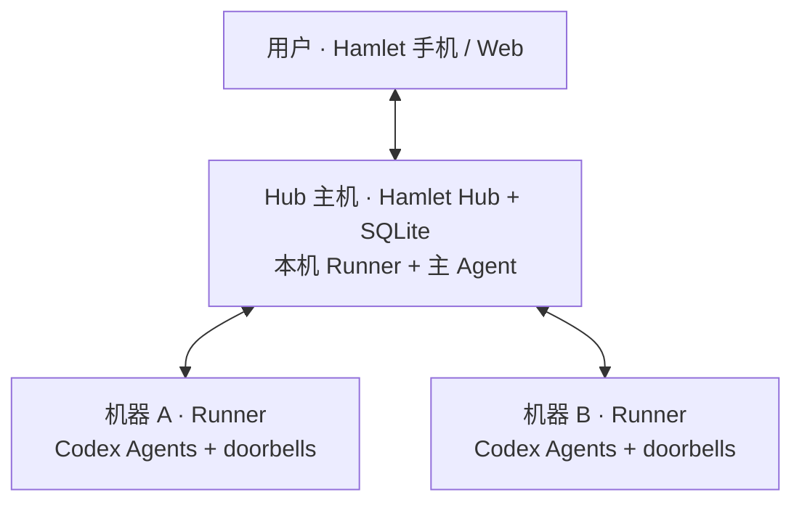

# Hamlet Hub 与常驻 Agent

设计范围为单 Hub、多机器、Codex Harness。Hamlet Hub 管理机器、会话、Agent 身份、群权限、消息与定时器。每台机器上的 Hamlet Runner 启动 Codex、维护工作目录并运行 doorbell 脚本。

## 部署

用户默认在主 Agent 的 Hamlet 会话交互，所有 Agent 均在 Hamlet 可见。Hub 的本机 Runner 在 Hub 工作目录下的专属目录启动第一个 Agent。每次创建和恢复会话时，Runner 都将秘书职责作为 developer instructions 注入。`POST /api/hamlet/main` 的可选 `prompt` 仅指定新建时的首轮任务。主助理在专属目录记录想法、需求和委派进展，向已有或新建的 Agent 分派工作，并向用户汇总。仅主 Agent 可通过 Hamlet 终端能力在指定在线机器执行 shell 命令。机器离线即返回，命令由主 Agent 视需要重新发起。

## 身份与权限

- 每个 Agent 有稳定的 ID、创建者给出的名字和一句话说明，以及 Hamlet 会话动态更新的 title。绑定 Hamlet 的稳定机器 ID 和当前会话 ID，界面显示可修改的机器名。
- 创建参数包括机器、目录、直接目录或 Git worktree、Harness、模型、思考强度、权限、协作模式、服务档位、初始 prompt、名字和说明。首版使用 Codex，固定 YOLO，默认 Default 协作和标准档位。创建使用干净会话，首轮 prompt 提交一次，后续唤醒恢复原会话。首版省略 fork 和自定义 system prompt。
- 所有 Agent 都能创建子 Agent，只能管理和单查、批查直属子 Agent。Agent 可查询自己的父节点、所加入的群和群成员。成员及直属节点查询返回 ID、名字、说明和 title。
- 群由父 Agent 创建和管理，可拉入位于任意机器的直属子 Agent，也可自行加入以接收广播。父子可双向私信。同群成员可私信或广播，成员变更和解散只由建群的父 Agent 操作。Hub 在每次查询、投递和管理操作时根据调用会话校验权限。
- 删除直属叶子节点可直接执行。有后代时先返回完整子树摘要和版本，父可携带版本及 force 确认级联。子树有变动则刷新预览。收尾覆盖运行、成员关系、监听和提醒，保留工作目录与产物。离线 Runner 的待清理状态可查询。

## 事件、时间与附件

- Hub 复用 Hamlet 的 SQLite。私信、广播、doorbell 和到期提醒都写入每个接收者的持久收件箱。广播按发送时的成员名单分发。忙碌时只入队，空闲时把领取时已积压的全部消息作为一个批次提交到同一会话。随后新到的事件进入下一批。离线时保留事件。
- 调度按 Agent 串行领取批次，使用批次 ID、Runner 接收回执和发起回合的关联记录处理重启与重试。跨机 RPC 位于数据库事务之外。聊天按时间显示初始提示词和每批领取的内部输入，用颜色和来源标签区分 Agent 来信、doorbell 和定时提醒。图文来信保留原图与说明。
- 父节点从 agent_list 取得直属子节点的 turn_id，可用 agent_interrupt 请求停止该回合，或用 agent_steer 向该回合追加文字和图片。纠正重试复用 request_id。回合已切换时返回 turn_changed，普通来信继续走收件箱。
- Timer 仅供 Agent 为自己登记，由 Hub 调度一次性跟进或周期任务。到期事件入箱与提醒状态更新在同一事务提交。一次性提醒逾期补投，周期任务错过多次默认合并。
- 派工后若需要等待，Agent 可单独调用 `wait_message` 结束本轮。已有积压及后续用户输入、Agent 来信、timer 和 doorbell 都可启动下一轮。目录监听等执行任务由承担任务的子节点创建自己的监听、处理文件并回报父节点。
- Doorbell 仅供 Agent 为自己创建和管理，每个监听有独立 ID。Hub 保存归属、机器和期望状态，目标机器的 Runner 托管监听、日志、游标和退避重启。外部事件带去重键，只投给所属 Agent。
- `message_to` 支持文字、纯图、图文、多图和逐图说明。发送方 Runner 上传本机文件到 Hub，或复用已有附件 ID。Hub 保存文件及访问关系，群广播复用同一份文件。接收端把图片和对应消息作为 Codex 原生图像输入。主 Agent 可在自己的会话用 `display_media` 引用同一附件向用户交付。

## MCP 工具范围

共有能力覆盖身份和机器查询、直属子节点管理、群管理与成员查询、消息投递、自己的 timer 和 doorbell 管理。主 Agent 另有按机器执行命令的工具。保留动态标题和一个统一的媒体展示入口。托管会话关闭三个 peer 工具，收紧其底层 API 访问，Runner 只在托管会话的 developer instructions 中提供协作 skill 的本机路径，Agent 可按需读取。工具名称见下方运行入口，参数定义在 shared/src/hamlet.ts。

## 模块与验收场景

| 阶段 | 改动位置与内容 | 验收 |
|---|---|---|
| 1. 身份与启动 | 在 shared 定义协议，在 Hub store 增加 Agent 记录，接入现有机器 RPC 和会话创建、恢复。先接主 Agent 和跨机子 Agent，再给托管会话绑定调用身份。 | 从 Hub 在另一台机器创建子 Agent；两者均在 Hamlet 可见；重复创建请求只产生一个逻辑 Agent 和一次首轮输入；机器改名后绑定有效。 |
| 2. 通信 | 在 Hub 实现父子、群、授权及持久收件箱；在 Runner/Codex 回合边界接入批次交付和恢复。MCP 通过这些服务操作。 | 同父跨机可通信、跨父受限；父可选择接收广播；运行中收到三条消息只新增一个后续回合；离线和回执丢失可恢复。 |
| 3. 时间与监听 | Hub 实现持久 timer。把旧 Hamlet 的 doorbell 脚本协议、状态目录和 supervisor 行为迁入每机 Runner，接入统一消息投递。 | 一次提醒跨 Hub 重启生效；监听跨 Runner 重启恢复；同一来源事件可去重；父不能替子配置监听和提醒。 |
| 4. 命令与媒体 | 给主 Agent 接入机器级终端执行；扩展 Hub 附件及媒体展示，让 Runner 交付文字与原生图片输入。 | 子 Agent 调远程终端被拒，离线命令不排队；子 Agent 发两张截图，主 Agent 能辨别像素差异并向用户展示指定原图。 |
| 5. 删除与切换 | 接入子树预览、版本校验、级联与离线清理。验证创建入口已切向 Hamlet 后，退出旧 Hamlet daemon、harness 和调度路径。 | 预览后新增子孙会使旧确认失效；删除后监听停止、产物保留；端到端验证仅由 Hamlet 启动和恢复托管 Agent。 |

## 运行入口

使用同一分支构建的 Hub 和 Runner。Hub 主机上使用同一个 HAMLET_HOME 启动 Hub 和本机 Runner；远端 Runner 的 HAMLET_API_URL 指向此 Hub，使用同一 namespace。Web 打开主助理时提供浏览器时区。Owner CLI 默认保留 Hub 已记录的时区，仅在显式设置 HAMLET_USER_TIMEZONE 时更新。时区变更在各 Agent 下次启动或恢复时生效。Runner 在启动和恢复时读取该时区，按事件发生日期显示本地时间与偏移。

每台执行机器都需要 Codex，使用脚本监听的机器还需要 Python 3。打开 Hamlet Web「创建会话」中的「打开 Hamlet 主助理」。重复打开返回同一会话。原 Hamlet 的 `node bin/hamlet.js start` 也连接这个入口。

查询身份、直属子节点或群成员时，`running` 表示 Codex 此刻是否在执行回合，`status` 区分 working、idle、inactive 和暂时无法确认的 unknown。`processing` 按投递顺序列出当前回合实际接收的输入，包括追加的用户消息和整个 Hamlet 事件批次。查询不会领取收件箱。自己和直属子节点可看完整输入，其他可见 Agent 只展示查询者自己发送或收过的事件，并返回隐藏条数。旧版 Runner 能报告状态，无法提供明细时返回 null。

管理工具按当前会话鉴权。共享 OS 账号和 YOLO 权限允许读取该账号可访问的文件，部署时需要将 Hamlet 管理凭据与不互信的执行环境隔离。权限规则覆盖 Hub API 与 MCP 调用。

| 用途 | MCP 工具 |
|---|---|
| 身份与机器 | whoami、machine_list，主 Agent 另有 machine_exec |
| 直属子节点 | agent_create、agent_list、agent_interrupt、agent_steer、agent_delete、agent_delete_status |
| 群 | group_create、group_update、group_delete、group_list、group_members |
| 消息与交付 | message_to、wait_message、display_media、change_title |
| 提醒与监听 | timer_create/list/delete、doorbell_create/list/enable/delete/logs |

agent_create 以调用者和 request_id 去重。群发的收件人为当前群中其他成员。图片可传发送方路径或已有 attachment_id。display_media 的 source 同样接受路径或附件 ID。Hub 以本地文件保存附件，SQLite 保存分发权限，接收方的 Codex 可直接读取图片，用户在 Hamlet 会话里的展示也可从 Hub 取回。

数据库从 v26 自动升级到 v27。会话和机器继续使用 Hamlet 原表，Hamlet Agent ID 与预留的会话 ID 一致。消息正文与收件记录分表，整批提交使用稳定 ID。Runner 在原生 Codex 队列确认消费后向 Hub 确认批次。旧 Hamlet 数据库留作历史归档。

### 从 Hub 安装 Runner

在 Hub 的「设置 → 设备 → 安装 Hamlet Runner」复制命令，在目标机器上执行。首次安装按提示输入登录令牌。该页也提供安装脚本和 macOS、Linux 的 x64 与 ARM64 下载链接。命令采用 Hub 配置的对外地址，脚本和二进制下载链接则使用当前浏览器连接的 Hub。

脚本、启动器、安装包和校验文件使用与 Hub 同源的认证下载接口。页面使用当前登录会话下载。终端命令在隐藏输入中读取一次访问令牌，安装器登录后使用短期会话令牌获取其余文件。测试 Hub 配置为 HTTP 时，页面会使用 `--allow-http`，令牌与文件在网络上以明文传输。

构建 Web 资源和嵌入清单、下载 tunwg 后，运行 `scripts/build-runner-dist.sh`，将四对 gzip 和 SHA-256 文件放在 Hub 的 `$HAMLET_HOME/runner-dist` 或 `HAMLET_RUNNER_DIST` 指定的目录。安装器需要 Python 3，默认安装在 `~/.local/share/hamlet-runner`，管理命令为 `hamlet runner` 或 `hamlet-runner`。运行 Codex 任务还需在目标机器安装并登录 Codex。
